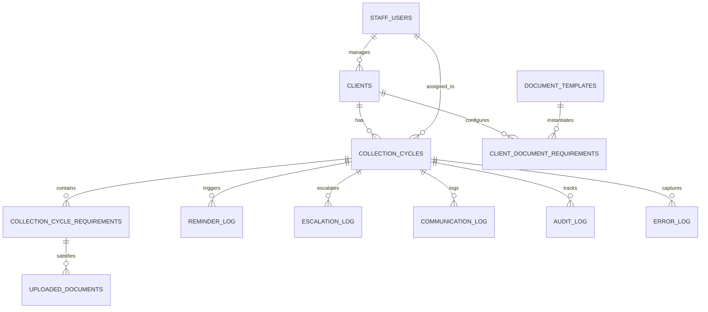
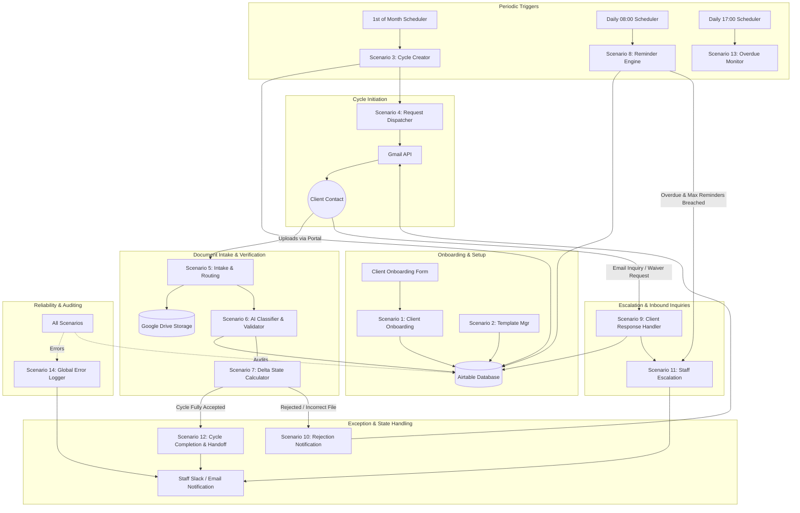
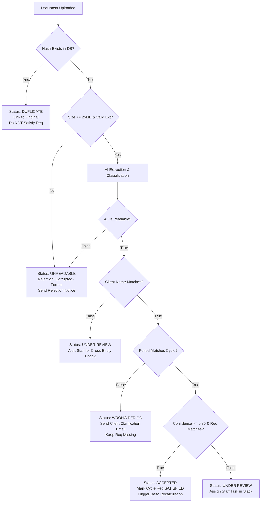
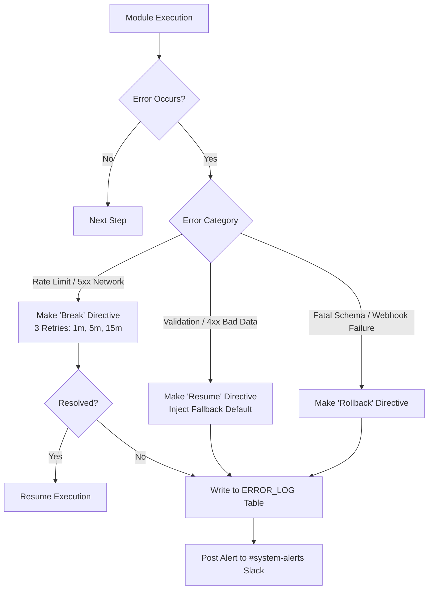

# Client Document Collection & Missing Document Follow-Up System
## Comprehensive Production Automation Architecture for Accounting Firms

---

### PART 1: EXECUTIVE TECHNICAL SUMMARY

#### 1.1 System Purpose & Mission
Accounting and bookkeeping practices lose between 15% and 25% of billable staff time chasing clients for financial documents, resolving mismatched reporting periods, untangling duplicate uploads, and interpreting unreadable files. The **Client Document Collection & Missing Document Follow-Up System** is an event-driven, state-machine-backed automation platform built on **Make.com**.

It manages the document collection lifecycle from recurring cycle creation through dynamic requirement checking, multi-stage intake, deterministic and AI-assisted validation, precision reminders, waiver approvals, internal escalations, and automated staff handoffs.

#### 1.2 Core Architectural Principles
1. **Deterministic-First State Engine:** Business logic, status transitions, cycle completion math, and reminder triggers are 100% deterministic. AI is strictly isolated to perceptual tasks (document classification, field extraction, unreadable file detection) and acts as an advisory sub-service.
2. **Idempotency & Concurrency Safety:** Every webhook intake, cycle generator, and reminder scenario enforces strict idempotency keys (e.g., `hash(client_id + period_start + period_end)`) and atomic status locks to prevent duplicate cycle creation, duplicate emails, and race conditions during simultaneous multi-file uploads.
3. **Decoupled Modular Topography:** Rather than a monolithic scenario, the architecture uses 10 decoupled Make.com scenarios communicating via asynchronous Webhooks and unified Database state.
4. **Dynamic Delta Reminders:** Clients are *never* reminded of documents that are already accepted, under review, or waived. Reminders only list the current missing delta with direct deep-links to upload missing items.
5. **Human-in-the-Loop Governance:** Low-confidence AI predictions, client waiver disputes, unidentifiable files, and repeated non-responsiveness are routed into structured staff escalation queues with contextual resolution actions.

---

### PART 2: RECOMMENDED MVP TECHNOLOGY STACK & JUSTIFICATION

| Component | Selected Technology | Alternative Evaluated | Justification & Trade-off Analysis |
| :--- | :--- | :--- | :--- |
| **Automation Engine** | **Make.com (Pro / Team Tier)** | Zapier, n8n | **Why:** Native webhook queuing, visual data-flow mapping, built-in error handling (`Break`, `Resume`, `Commit`), advanced array aggregators/iterators, and native integrations with Google Workspace, Airtable, and OpenAI. |
| **Relational Database** | **Airtable** | Google Sheets, Supabase, Notion | **Why:** Native relational schema support (linked records, lookup/rollup fields, formula fields), atomic record updates, instant API key/PAT generation, built-in view webhooks, and visual interface for accounting staff without custom UI coding.<br>*Why not Sheets:* Google Sheets suffers from race conditions, lacks field-type constraints, and has severe row-locking limits.<br>*Why not Supabase for MVP:* Adds unnecessary SQL/API overhead for non-developer accounting staff. |
| **File Storage & Hierarchy** | **Google Drive (Workspace Enterprise)** | Dropbox, OneDrive, AWS S3 | **Why:** Seamless integration with Gmail/Google Workspace, granular folder sharing permissions, robust file ID tracking, search capabilities, and native thumbnail/preview generation for staff review. |
| **Client Communication** | **Gmail API / Google Workspace** | Outlook 365, SendGrid | **Why:** High inbox deliverability, supports shared inboxes/aliases (e.g., `bookkeeping@firm.com`), threading via `Message-ID` / `References` headers, and low integration friction in Make. |
| **Intake Portal (MVP)** | **Fillout / Tally Forms (Airtable-backed)** | Custom React Portal | **Why:** Generates secure pre-filled forms tied to Airtable `cycle_id` and `client_id`, supports multi-file drag-and-drop, validates file extensions client-side, and directly triggers Make intake webhooks without front-end dev cost. |
| **AI Classification** | **OpenAI GPT-4o-mini via Make REST** | Anthropic Claude 3.5 Sonnet, AWS Textract | **Why:** Cost-effective ($0.15/1M tokens), high accuracy on vision/PDF layout classification, structured JSON Schema response enforcement (`response_format: { type: "json_object" }`), and sub-second latency. |

---

### PART 3: COMPLETE DATABASE SCHEMA (AIRTABLE / RELATIONAL)



#### Table 1: `CLIENTS`
*Tracks client company information, contact details, accounting schedules, and assigned staff.*
* `client_id` (Formula/Text, Primary Key, Unique, Indexed): `REC_CLI_` & Autonumber. (e.g., `CLI-1001`)
* `client_name` (Single Line Text, Required): `Apex Logistics LLC`
* `legal_business_name` (Single Line Text, Required): `Apex Logistics Holding Corp.`
* `contact_name` (Single Line Text, Required): `Marcus Vance`
* `primary_email` (Email, Required, Indexed): `marcus@apexlogistics.com`
* `secondary_email` (Email, Optional): `ap@apexlogistics.com`
* `phone` (Phone Number, Optional): `+1-555-839-2001`
* `preferred_contact_method` (Single Select, Required): `Email` (`Email`, `SMS`, `Portal`)
* `reporting_frequency` (Single Select, Required): `Monthly` (`Monthly`, `Quarterly`, `Annually`, `Custom`)
* `reporting_period_start_day` (Number, Required, Default: 1): `1`
* `standard_deadline_days_after_period` (Number, Required, Default: 7): `7`
* `assigned_staff_id` (Link to `STAFF_USERS`, Required): Linked ID to Staff record
* `default_template_id` (Link to `DOCUMENT_TEMPLATES`, Required): Linked ID to Template
* `client_status` (Single Select, Required, Default: `Active`): `Active` (`Active`, `Paused`, `Onboarding`, `Offboarded`)
* `storage_folder_id` (Single Line Text, Required): Google Drive Folder ID (e.g., `1aBcD_092834xyz`)
* `custom_upload_token` (Single Line Text, Unique, Indexed): Secure UUID token for upload portal URLs
* `created_at` (Created Time): ISO 8601 timestamp
* `updated_at` (Last Modified Time): ISO 8601 timestamp

#### Table 2: `STAFF_USERS`
*Internal accounting and bookkeeping team members.*
* `staff_id` (Single Line Text, Primary Key, Unique): `STF-01`
* `full_name` (Single Line Text, Required): `Sarah Jenkins, CPA`
* `email` (Email, Required, Unique): `sarah.jenkins@firmcpa.com`
* `role` (Single Select, Required): `Senior Bookkeeper` (`Bookkeeper`, `Senior Bookkeeper`, `Manager`, `Partner`, `Admin`)
* `slack_user_id` (Single Line Text, Optional): `U04829AB8`
* `is_active` (Checkbox, Default: True): `True`

#### Table 3: `DOCUMENT_TEMPLATES`
*Master definitions of document requirement sets (e.g., Standard Monthly Bookkeeping, E-commerce, Construction).*
* `template_id` (Single Line Text, Primary Key, Unique): `TPL-MB-STD`
* `template_name` (Single Line Text, Required): `Monthly Bookkeeping - Standard Small Business`
* `industry_type` (Single Select, Required): `General / Service` (`General / Service`, `E-Commerce`, `Construction`, `Real Estate`, `Healthcare`)
* `description` (Long Text): Standard monthly checklist including checking accounts, credit cards, payroll summaries, and major supplier invoices.
* `is_active` (Checkbox, Default: True): `True`

#### Table 4: `CLIENT_DOCUMENT_REQUIREMENTS`
*Client-specific customized blueprint of required documents inherited from templates or added custom.*
* `client_req_id` (Single Line Text, Primary Key, Unique): `CREQ-1001-01`
* `client_id` (Link to `CLIENTS`, Required): Linked Client
* `template_id` (Link to `DOCUMENT_TEMPLATES`, Optional): Source template
* `document_name` (Single Line Text, Required): `Chase Primary Checking Statement`
* `document_type_code` (Single Select, Required): `BANK_STATEMENT` (`BANK_STATEMENT`, `CREDIT_CARD_STATEMENT`, `SALES_REPORT`, `PAYROLL_SUMMARY`, `EXPENSE_RECEIPTS`, `SUPPLIER_INVOICE`, `TAX_RETURN`, `LOAN_STATEMENT`, `MERCHANT_STATEMENT`, `CUSTOM`)
* `description_instructions` (Long Text): Please provide the official PDF statement covering the full calendar month from Chase account ending in #4092.
* `required_or_optional` (Single Select, Required, Default: `Required`): `Required` (`Required`, `Optional`, `Conditional`)
* `condition_expression` (Long Text, Optional): `client.has_payroll == true`
* `accepted_file_extensions` (Multiple Select, Required): `PDF`, `CSV`, `XLSX` (`PDF`, `CSV`, `XLSX`, `PNG`, `JPG`)
* `max_file_size_mb` (Number, Default: 25): `25`
* `validation_keywords` (Long Text): `JPMorgan Chase, Ending Balance, Statement Period, Account Number ...4092`
* `reminder_enabled` (Checkbox, Default: True): `True`
* `is_active` (Checkbox, Default: True): `True`

#### Table 5: `COLLECTION_CYCLES`
*State machine entity tracking a single document collection period for a client.*
* `cycle_id` (Single Line Text, Primary Key, Unique, Indexed): `CYC-CLI1001-2026-04`
* `client_id` (Link to `CLIENTS`, Required): Linked Client
* `cycle_name` (Single Line Text, Required): `April 2026 Monthly Bookkeeping`
* `reporting_frequency` (Single Select, Required): `Monthly`
* `reporting_period_start` (Date, Required): `2026-04-01`
* `reporting_period_end` (Date, Required): `2026-04-30`
* `cycle_open_date` (Date, Required): `2026-05-01`
* `document_due_date` (Date, Required): `2026-05-08`
* `cycle_status` (Single Select, Required, Default: `Draft`): `Active` (`Draft`, `Active`, `Under Review`, `Completed`, `Overdue`, `Escalated`, `Paused`, `Cancelled`)
* `total_required_count` (Rollup/Formula, Number): `5`
* `total_accepted_count` (Rollup/Formula, Number): `4`
* `total_waived_count` (Rollup/Formula, Number): `1`
* `total_missing_count` (Rollup/Formula, Number): `0`
* `total_under_review_count` (Rollup/Formula, Number): `0`
* `total_rejected_count` (Rollup/Formula, Number): `0`
* `completion_percentage` (Formula, Percent): `100%` (`(total_accepted + total_waived) / total_required`)
* `first_request_sent_at` (Date/Time, Optional): `2026-05-01T08:00:00Z`
* `latest_reminder_sent_at` (Date/Time, Optional): `2026-05-05T08:00:00Z`
* `next_scheduled_reminder_at` (Date/Time, Optional): `2026-05-09T08:00:00Z`
* `reminder_count` (Number, Default: 0): `2`
* `max_reminders_allowed` (Number, Default: 4): `4`
* `escalation_level` (Single Select, Default: `None`): `None` (`None`, `Level 1 - Bookkeeper Alert`, `Level 2 - Manager Escalation`, `Level 3 - Phone Followup`, `Level 4 - Executive Review`)
* `completed_at` (Date/Time, Optional): `2026-05-07T14:22:10Z`
* `assigned_staff_id` (Link to `STAFF_USERS`, Required): Link to Staff
* `idempotency_key` (Single Line Text, Unique, Indexed): `CLI-1001_2026-04-01_2026-04-30`

#### Table 6: `COLLECTION_CYCLE_REQUIREMENTS`
*The active checklist of required documents for a specific collection cycle.*
* `cycle_req_id` (Single Line Text, Primary Key, Unique, Indexed): `CREQ-CYC1001-04-01`
* `cycle_id` (Link to `COLLECTION_CYCLES`, Required): Linked Cycle
* `client_req_id` (Link to `CLIENT_DOCUMENT_REQUIREMENTS`, Required): Source Client Requirement
* `document_name` (Single Line Text, Required): `Chase Primary Checking Statement`
* `document_type_code` (Single Select, Required): `BANK_STATEMENT`
* `requirement_status` (Single Select, Required, Default: `Requested`): `Accepted` (`Not Requested`, `Requested`, `Reminder Sent`, `Uploaded`, `Under Review`, `Accepted`, `Rejected`, `Duplicate`, `Incorrect Document`, `Wrong Period`, `Unreadable`, `Missing`, `Escalated`, `Waived`)
* `is_mandatory` (Checkbox, Default: True): `True`
* `satisfied_by_document_id` (Link to `UPLOADED_DOCUMENTS`, Optional): Linked Upload ID
* `status_reason_notes` (Long Text, Optional): `AI verified match for Chase Checking #4092 for April 2026 with 98% confidence.`
* `waived_reason` (Long Text, Optional): ``
* `waived_by_staff_id` (Link to `STAFF_USERS`, Optional): ``
* `waived_at` (Date/Time, Optional): ``
* `last_status_change_at` (Date/Time): `2026-05-03T11:15:00Z`

#### Table 7: `UPLOADED_DOCUMENTS`
*Granular metadata and verification logs for every single file received.*
* `upload_id` (Single Line Text, Primary Key, Unique, Indexed): `UPL-849204`
* `client_id` (Link to `CLIENTS`, Required): Linked Client
* `cycle_id` (Link to `COLLECTION_CYCLES`, Required): Linked Cycle
* `matched_cycle_req_id` (Link to `COLLECTION_CYCLE_REQUIREMENTS`, Optional): Linked Cycle Req
* `original_file_name` (Single Line Text, Required): `Statement-Apr2026-4092.pdf`
* `normalized_file_name` (Single Line Text, Required): `CLI1001_2026-04_BANK_STATEMENT_Chase-4092.pdf`
* `file_size_bytes` (Number, Required): `4194304` (4MB)
* `mime_type` (Single Line Text, Required): `application/pdf`
* `file_sha256_hash` (Single Line Text, Required, Indexed): `e3b0c44298fc1c149afbf4c8996fb92427ae41e4649b934ca495991b7852b855`
* `storage_drive_file_id` (Single Line Text, Required): `1xY9z0_GoogleDriveFileId`
* `storage_web_view_link` (URL, Required): `https://drive.google.com/file/d/1xY9z0_.../view`
* `upload_timestamp` (Date/Time, Required): `2026-05-03T11:14:02Z`
* `uploaded_by_email` (Email, Required): `marcus@apexlogistics.com`
* `upload_source` (Single Select, Required): `Fillout Portal` (`Fillout Portal`, `Email Attachment`, `Direct Drive Upload`, `Staff Manual Upload`)
* `claimed_document_type` (Single Line Text): `Bank Statement`
* `ai_predicted_type` (Single Line Text): `BANK_STATEMENT`
* `ai_confidence_score` (Number, Float 0.00-1.00): `0.98`
* `ai_detected_period_start` (Date): `2026-04-01`
* `ai_detected_period_end` (Date): `2026-04-30`
* `ai_detected_entity_name` (Single Line Text): `Apex Logistics LLC`
* `ai_detected_account_last4` (Single Line Text): `4092`
* `ai_raw_json_response` (Long Text): JSON payload
* `validation_status` (Single Select, Required, Default: `Uploaded`): `Accepted` (`Uploaded`, `Under Review`, `Accepted`, `Rejected`, `Duplicate`, `Incorrect Document`, `Wrong Period`, `Unreadable`)
* `rejection_reason_code` (Single Select): `None` (`None`, `WRONG_PERIOD`, `INCORRECT_ACCOUNT`, `INCORRECT_CLIENT`, `CORRUPTED_FILE`, `UNREADABLE_SCAN`, `DUPLICATE_FILE`, `MISSING_PAGES`)
* `client_facing_rejection_explanation` (Long Text): ``
* `reviewer_staff_id` (Link to `STAFF_USERS`, Optional): Link to Staff
* `reviewed_at` (Date/Time, Optional): ``
* `duplicate_of_upload_id` (Link to `UPLOADED_DOCUMENTS`, Optional): ``

#### Table 8: `REMINDER_LOG`
*Chronological log of all system-generated reminder dispatches.*
* `reminder_id` (Single Line Text, Primary Key, Unique): `REM-90281`
* `cycle_id` (Link to `COLLECTION_CYCLES`, Required): Linked Cycle
* `client_id` (Link to `CLIENTS`, Required): Linked Client
* `recipient_email` (Email, Required): `marcus@apexlogistics.com`
* `reminder_sequence_number` (Number, Required): `1` (1 = First, 2 = Second, 3 = Third, 4 = Final)
* `sent_timestamp` (Date/Time, Required): `2026-05-05T08:00:00Z`
* `missing_items_included` (Long Text, Required): `Chase Primary Checking Statement, Stripe Monthly Report`
* `email_subject` (Single Line Text, Required): `Reminder (2 missing items): Documents needed for April 2026 bookkeeping - Apex Logistics LLC`
* `delivery_status` (Single Select, Required): `Delivered` (`Queued`, `Sent`, `Delivered`, `Bounced`, `Failed`)

#### Table 9: `ESCALATION_LOG`
*Internal alert history when client non-responsiveness breaches SLA thresholds.*
* `escalation_id` (Single Line Text, Primary Key, Unique): `ESC-4029`
* `cycle_id` (Link to `COLLECTION_CYCLES`, Required): Linked Cycle
* `escalation_level` (Single Select, Required): `Level 2 - Manager Escalation`
* `triggered_at` (Date/Time, Required): `2026-05-15T09:00:00Z`
* `target_staff_id` (Link to `STAFF_USERS`, Required): Linked Staff
* `reason_description` (Long Text, Required): `Client has received 4 automated reminders and is 7 days past the due date. 2 documents still outstanding.`
* `action_taken` (Long Text, Optional): `Manager called client phone +1-555-839-2001. Left voicemail and sent personal direct email.`
* `is_resolved` (Checkbox, Default: False): `False`
* `resolved_at` (Date/Time, Optional): ``

#### Table 10: `COMMUNICATION_LOG`
*Complete history of inbound and outbound emails, webhook notifications, and SMS.*
* `comm_id` (Single Line Text, Primary Key, Unique): `COM-78291`
* `cycle_id` (Link to `COLLECTION_CYCLES`, Optional): Linked Cycle
* `client_id` (Link to `CLIENTS`, Required): Linked Client
* `direction` (Single Select, Required): `Outbound` (`Outbound`, `Inbound`)
* `channel` (Single Select, Required): `Email` (`Email`, `SMS`, `Portal_Notification`, `Internal_Slack`)
* `sender` (Single Line Text, Required): `bookkeeping@firmcpa.com`
* `recipient` (Single Line Text, Required): `marcus@apexlogistics.com`
* `subject_or_summary` (Single Line Text): `Documents needed for April 2026 bookkeeping`
* `body_text` (Long Text): Rendered email content
* `timestamp` (Date/Time, Required): `2026-05-01T08:00:05Z`
* `external_message_id` (Single Line Text): Gmail Message ID / Thread ID

#### Table 11: `ERROR_LOG`
*System resilience and exception management repository.*
* `error_id` (Single Line Text, Primary Key, Unique): `ERR-5501`
* `scenario_name` (Single Line Text, Required): `SCENARIO 5 - Document Upload Intake & Processing`
* `make_execution_id` (Single Line Text): `19283471029`
* `client_id` (Link to `CLIENTS`, Optional): `CLI-1001`
* `cycle_id` (Link to `COLLECTION_CYCLES`, Optional): `CYC-CLI1001-2026-04`
* `upload_id` (Link to `UPLOADED_DOCUMENTS`, Optional): `UPL-849204`
* `error_type` (Single Select, Required): `AI_API_TIMEOUT` (`DATABASE_UNAVAILABLE`, `STORAGE_UPLOAD_FAILED`, `AI_API_TIMEOUT`, `AI_MALFORMED_JSON`, `EMAIL_SEND_FAILED`, `WEBHOOK_DUPLICATE`, `INVALID_DATA_SCHEMA`, `RATE_LIMIT_EXCEEDED`)
* `error_message` (Long Text, Required): `OpenAI API returned 504 Gateway Timeout on file analysis.`
* `raw_payload` (Long Text): JSON string of trigger input
* `retry_count` (Number, Default: 0): `3`
* `resolution_status` (Single Select, Default: `Open`): `Resolved` (`Open`, `Retrying`, `Manual_Intervention_Required`, `Resolved`, `Ignored`)
* `resolved_at` (Date/Time, Optional): `2026-05-03T11:20:00Z`
* `resolved_by_staff_id` (Link to `STAFF_USERS`, Optional): Link to Staff

#### Table 12: `AUDIT_LOG`
*Immutable historical record for accounting compliance and client disputes.*
* `audit_id` (Single Line Text, Primary Key, Unique): `AUD-9021`
* `event_timestamp` (Date/Time, Required): `2026-05-07T14:22:10Z`
* `actor_type` (Single Select, Required): `System_Automation` (`System_Automation`, `Client_User`, `Staff_User`)
* `actor_identifier` (Single Line Text, Required): `Make_Scenario_12_Completion`
* `event_action` (Single Line Text, Required): `CYCLE_MARKED_COMPLETED`
* `target_entity_type` (Single Line Text, Required): `COLLECTION_CYCLES`
* `target_entity_id` (Single Line Text, Required): `CYC-CLI1001-2026-04`
* `previous_state_json` (Long Text): `{"cycle_status": "Active", "total_missing": 1}`
* `new_state_json` (Long Text): `{"cycle_status": "Completed", "total_missing": 0, "completed_at": "2026-05-07T14:22:10Z"}`
* `ip_address` (Single Line Text): `192.168.1.1`

---

### PART 4: COMPLETE SYSTEM ARCHITECTURE & DATA FLOW



---

### PART 5 & 6: SCENARIO-BY-SCENARIO ARCHITECTURE & MODULE-BY-MODULE SPECIFICATION

To ensure zero ambiguity, the 15 functional requirements are structured into **10 high-performance, modular Make.com scenarios** (optimizing execution operations while maintaining clean architectural isolation):

```
SCENARIO 1:  Client Onboarding & Requirement Profile Provisioning
SCENARIO 2:  Recurring Collection Cycle Generator (Idempotent)
SCENARIO 3:  Initial Document Request Dispatcher
SCENARIO 4:  Document Intake, Duplicate Hashing & Storage Filing
SCENARIO 5:  AI-Assisted Classification & Deterministic Validation Pipeline
SCENARIO 6:  Missing-Document Delta Calculator & Cycle State Machine
SCENARIO 7:  Precision Scheduled Reminder & Escalation Dispatcher
SCENARIO 8:  Client Inbound Response & Self-Attestation/Waiver Router
SCENARIO 9:  Rejected/Incorrect Document Feedback Loop
SCENARIO 10: Collection Cycle Completion & Staff Handoff Notification
(Cross-Cutting: Scenarios 11-15 are integrated into System Monitoring, Daily Sweep, and Error Break Handlers)
```

---

#### SCENARIO 1: Client Onboarding & Requirement Profile Provisioning
* **Scenario ID:** `SCEN-01-ONBOARD`
* **Trigger:** Airtable Webhook on `CLIENTS` table when `client_status = "Onboarding"` (or Form Submission Webhook).
* **Schedule:** On-Demand Webhook.
* **Idempotency Rule:** Checks if `storage_folder_id` and `CLIENT_DOCUMENT_REQUIREMENTS` already exist for `client_id`. If exists, abort.

```
[M1: Custom Webhook]
  └──> [M2: Airtable - Get Client Record (client_id)]
        └──> [M3: Router]
              ├── Branch A: Validation Failed (Missing primary_email, legal_name, or default_template_id)
              │     └──> [M4: Gmail - Send Internal Alert to Admin ("Onboarding Incomplete for Client")]
              │     └──> [M5: Airtable - Update Client Record (client_status = "Error")]
              │
              └── Branch B: Validation Passed
                    └──> [M6: Google Drive - Create Folder ("Clients / {client_name} - {client_id}")]
                    └──> [M7: Google Drive - Create Subfolder ("Archive / Raw Uploads")]
                    └──> [M8: Airtable - Search Records in `DOCUMENT_TEMPLATES` (template_id = client.default_template_id)]
                    └──> [M9: Airtable - Search Records in `TEMPLATE_REQUIREMENTS` (template_id = client.default_template_id)]
                    └──> [M10: Iterator - Loop through Template Requirements]
                          └──> [M11: Airtable - Create Record in `CLIENT_DOCUMENT_REQUIREMENTS`]
                                Mapping: {
                                  client_id: M2.client_id,
                                  document_name: M10.document_name,
                                  document_type_code: M10.document_type_code,
                                  description_instructions: M10.description_instructions,
                                  required_or_optional: M10.required_or_optional,
                                  accepted_file_extensions: M10.accepted_file_extensions,
                                  validation_keywords: M10.validation_keywords,
                                  is_active: true
                                }
                    └──> [M12: Tools - Text Aggregator (Aggregate created requirement IDs)]
                    └──> [M13: Airtable - Update Client Record]
                          Mapping: {
                            storage_folder_id: M6.id,
                            custom_upload_token: generateUUID(),
                            client_status: "Active"
                          }
                    └──> [M14: Airtable - Create Record in `AUDIT_LOG` ("CLIENT_ONBOARDED_SUCCESSFULLY")]
                    └──> [M15: Slack - Send Message to #accounting-team ("New Client Active: {client_name}")]
```

* **Error Handling (M6 Google Drive / M11 Airtable):**
  * Route: Attached `Break` directive (3 attempts, 5-minute interval).
  * On final failure: Route to `Airtable - Create Record in ERROR_LOG` + `Slack Alert`.

---

#### SCENARIO 2: Recurring Collection Cycle Generator
* **Scenario ID:** `SCEN-02-CYCLE-GEN`
* **Trigger:** Scheduled Cron (1st day of every month at 01:00 UTC).
* **Purpose:** Evaluates all active clients, computes the previous reporting period, builds the cycle, copies active requirements, and computes initial missing count.
* **Idempotency Rule:** `idempotency_key = "{client_id}_{reporting_period_start}_{reporting_period_end}"`. Checks for existing record before insert.

```
[M1: Scheduler (01:00 UTC 1st of Month)]
  └──> [M2: Tools - Set Variables]
        Variables: {
          period_start: formatDate(addMonths(now; -1); "YYYY-MM-01"),
          period_end: formatDate(addDays(formatDate(now; "YYYY-MM-01"); -1); "YYYY-MM-DD"),
          cycle_month_name: formatDate(addMonths(now; -1); "MMMM YYYY")
        }
  └──> [M3: Airtable - Search Records in `CLIENTS` (Filter: client_status = "Active" AND reporting_frequency = "Monthly")]
  └──> [M4: Iterator - Process Each Active Client]
        └──> [M5: Tools - Set Variable]
              idempotency_key: M4.client_id + "_" + M2.period_start + "_" + M2.period_end
        └──> [M6: Airtable - Search Records in `COLLECTION_CYCLES` (Filter: idempotency_key = M5.idempotency_key)]
        └──> [M7: Router]
              ├── Branch A: Filter (length(M6.records) > 0) -> [M8: Tools - Ignore / Log "Cycle Already Exists"]
              │
              └── Branch B: Filter (length(M6.records) == 0) -> Cycle Does Not Exist
                    └──> [M9: Tools - Set Variable]
                          due_date: formatDate(addDays(now; M4.standard_deadline_days_after_period); "YYYY-MM-DD")
                    └──> [M10: Airtable - Create Record in `COLLECTION_CYCLES`]
                          Mapping: {
                            cycle_id: "CYC-" + M4.client_id + "-" + formatDate(M2.period_start; "YYYYMM"),
                            client_id: [M4.id],
                            cycle_name: M2.cycle_month_name + " Bookkeeping Collection",
                            reporting_frequency: "Monthly",
                            reporting_period_start: M2.period_start,
                            reporting_period_end: M2.period_end,
                            cycle_open_date: formatDate(now; "YYYY-MM-DD"),
                            document_due_date: M9.due_date,
                            cycle_status: "Draft",
                            assigned_staff_id: [M4.assigned_staff_id],
                            idempotency_key: M5.idempotency_key
                          }
                    └──> [M11: Airtable - Search Records in `CLIENT_DOCUMENT_REQUIREMENTS` (client_id = M4.id AND is_active = true)]
                    └──> [M12: Iterator - Loop Active Client Requirements]
                          └──> [M13: Airtable - Create Record in `COLLECTION_CYCLE_REQUIREMENTS`]
                                Mapping: {
                                  cycle_req_id: "CREQ-" + M10.id + "-" + M12.id,
                                  cycle_id: [M10.id],
                                  client_req_id: [M12.id],
                                  document_name: M12.document_name,
                                  document_type_code: M12.document_type_code,
                                  requirement_status: "Requested",
                                  is_mandatory: if(M12.required_or_optional == "Required"; true; false),
                                  last_status_change_at: now
                                }
                    └──> [M14: Tools - Numeric Aggregator (Count Created Requirements)]
                    └──> [M15: Airtable - Update Record in `COLLECTION_CYCLES` (ID = M10.id)]
                          Mapping: {
                            cycle_status: "Active",
                            total_required_count: M14.count
                          }
                    └──> [M16: HTTP - Trigger Webhook for Scenario 3 (Initial Request Dispatcher)]
                          Body: { cycle_id: M10.id, client_id: M4.id }
```

---

#### SCENARIO 3: Initial Document Request Dispatcher
* **Scenario ID:** `SCEN-03-REQ-DISPATCH`
* **Trigger:** Webhook from Scenario 2 (or manual staff re-trigger).
* **Purpose:** Compiles personalized checklist, constructs secure upload link, generates professional email, updates cycle timestamps, and records audit trail.

```
[M1: Custom Webhook (cycle_id, client_id)]
  └──> [M2: Airtable - Get Record `COLLECTION_CYCLES` (cycle_id)]
  └──> [M3: Airtable - Get Record `CLIENTS` (client_id)]
  └──> [M4: Airtable - Search Records `COLLECTION_CYCLE_REQUIREMENTS` (cycle_id = M1.cycle_id AND is_mandatory = true)]
  └──> [M5: Tools - Text Aggregator]
        Row format: "• <strong>{{document_name}}</strong>: {{description_instructions}} (Accepted formats: {{accepted_file_extensions}})"
  └──> [M6: Tools - Set Variable (Portal Link)]
        upload_url: "https://portal.firmcpa.com/upload?token=" + M3.custom_upload_token + "&cycle=" + M2.cycle_id
  └──> [M7: Gmail - Send Email]
        To: M3.primary_email
        Cc: M3.secondary_email
        From: "Firm Bookkeeping <bookkeeping@firmcpa.com>"
        Subject: "Documents Needed: " + M2.cycle_name + " – " + M3.client_name
        HTML Body: [Template 1 Rendered - See Part 10]
  └──> [M8: Airtable - Update Record `COLLECTION_CYCLES` (M2.id)]
        Mapping: {
          first_request_sent_at: now,
          latest_reminder_sent_at: now,
          next_scheduled_reminder_at: addDays(now; 3),
          reminder_count: 0
        }
  └──> [M9: Airtable - Create Record in `COMMUNICATION_LOG`]
        Mapping: {
          client_id: [M3.id],
          cycle_id: [M2.id],
          direction: "Outbound",
          channel: "Email",
          recipient: M3.primary_email,
          subject_or_summary: "Initial Document Request for " + M2.cycle_name,
          body_text: M7.body,
          external_message_id: M7.messageId
        }
  └──> [M10: Airtable - Create Record in `AUDIT_LOG` ("INITIAL_REQUEST_DISPATCHED")]
```

---

#### SCENARIO 4: Document Intake, Duplicate Hashing & Storage Filing
* **Scenario ID:** `SCEN-04-INTAKE`
* **Trigger:** Webhook from Fillout / Portal Form upon file upload.
* **Payload:** `{ upload_token, cycle_id, file_url, original_filename, claimed_doc_type, uploader_email }`

```
[M1: Intake Webhook]
  └──> [M2: Airtable - Search Records `CLIENTS` (custom_upload_token = M1.upload_token)]
        Filter: length(records) > 0 (Verify valid token)
  └──> [M3: Airtable - Get Record `COLLECTION_CYCLES` (cycle_id = M1.cycle_id)]
  └──> [M4: HTTP - Get a File (Download from temporary portal storage URL)]
  └──> [M5: Tools - Compute Hash & Metadata]
        sha256: sha256(M4.data),
        size_mb: M4.size / 1048576,
        file_ext: lower(last(split(M1.original_filename; ".")))
  └──> [M6: Router]
        ├── Branch A: Invalid File (size_mb > 25 OR file_ext NOT IN ["pdf", "csv", "xlsx", "png", "jpg"])
        │     └──> [M7: Airtable - Create Record in `UPLOADED_DOCUMENTS` (validation_status = "Unreadable", rejection_reason_code = "CORRUPTED_FILE")]
        │     └──> [M8: HTTP - Call Scenario 9 (Rejection Feedback)]
        │
        └── Branch B: Valid File Structure
              └──> [M9: Airtable - Search Records in `UPLOADED_DOCUMENTS` (file_sha256_hash = M5.sha256 AND client_id = M2.id)]
              └──> [M10: Router]
                    ├── Branch B1: Exact Duplicate Detected (length(M9.records) > 0)
                    │     └──> [M11: Airtable - Create Record in `UPLOADED_DOCUMENTS` (validation_status = "Duplicate", duplicate_of_upload_id = [M9.records[1].id])]
                    │     └──> [M12: Airtable - Create Record in `AUDIT_LOG` ("DUPLICATE_FILE_SKIPPED")]
                    │
                    └── Branch B2: New Unique File
                          └──> [M13: Tools - Set Variable (Normalized Name)]
                                normalized_name: M2.client_id + "_" + formatDate(M3.reporting_period_start; "YYYY-MM") + "_" + upper(M1.claimed_doc_type) + "_" + M1.original_filename
                          └──> [M14: Google Drive - Upload File]
                                Folder ID: M2.storage_folder_id,
                                File Name: M13.normalized_name,
                                Data: M4.data
                          └──> [M15: Airtable - Create Record in `UPLOADED_DOCUMENTS`]
                                Mapping: {
                                  upload_id: "UPL-" + timestamp,
                                  client_id: [M2.id],
                                  cycle_id: [M3.id],
                                  original_file_name: M1.original_filename,
                                  normalized_file_name: M13.normalized_name,
                                  file_size_bytes: M4.size,
                                  mime_type: M4.mimeType,
                                  file_sha256_hash: M5.sha256,
                                  storage_drive_file_id: M14.id,
                                  storage_web_view_link: M14.webViewLink,
                                  upload_timestamp: now,
                                  uploaded_by_email: M1.uploader_email,
                                  upload_source: "Fillout Portal",
                                  claimed_document_type: M1.claimed_doc_type,
                                  validation_status: "Uploaded"
                                }
                          └──> [M16: HTTP - Trigger Scenario 5 (AI Classification & Validation Pipeline)]
                                Body: { upload_id: M15.id, drive_file_id: M14.id, cycle_id: M3.id }
```

---

#### SCENARIO 5: AI-Assisted Classification & Deterministic Validation Pipeline
* **Scenario ID:** `SCEN-05-AI-VALIDATE`
* **Trigger:** Webhook from Scenario 4 (or manual staff re-classification).
* **Architecture:** Combines GPT-4o-mini structured analysis with rigid deterministic boundary checking.

```
[M1: Custom Webhook (upload_id, drive_file_id, cycle_id)]
  └──> [M2: Airtable - Get Record `UPLOADED_DOCUMENTS` (upload_id)]
  └──> [M3: Airtable - Get Record `COLLECTION_CYCLES` (cycle_id)]
  └──> [M4: Airtable - Get Record `CLIENTS` (M3.client_id)]
  └──> [M5: Airtable - Search `COLLECTION_CYCLE_REQUIREMENTS` (cycle_id = M3.id)]
  └──> [M6: Google Drive - Download File / Generate Thumbnail or Text Snippet]
  └──> [M7: OpenAI - Structured Classification (GPT-4o-mini)]
        System Prompt: [See Part 9 for Exact Schema & Rules]
        User Content: File data + Client Name + Reporting Period Strings
  └──> [M8: JSON Parser - Parse OpenAI Structured Response]
  └──> [M9: Router - Deterministic Validation Decision Tree]
        │
        ├── Branch 1: Unreadable / Corrupt
        │   Condition: M8.is_readable == false OR M8.confidence_score < 0.30
        │   ├──> [M10: Airtable - Update `UPLOADED_DOCUMENTS` (validation_status = "Unreadable", rejection_reason_code = "UNREADABLE_SCAN")]
        │   └──> [M11: HTTP - Trigger Scenario 9 (Rejection Loop)]
        │
        ├── Branch 2: Wrong Client Identity
        │   Condition: M8.probable_client_name != "" AND NOT contains(lower(M4.client_name); lower(M8.probable_client_name)) AND NOT contains(lower(M4.legal_business_name); lower(M8.probable_client_name))
        │   ├──> [M12: Airtable - Update `UPLOADED_DOCUMENTS` (validation_status = "Under Review", rejection_reason_code = "INCORRECT_CLIENT")]
        │   └──> [M13: Slack - Alert Bookkeeper ("File uploaded appears to belong to another entity")]
        │
        ├── Branch 3: Wrong Reporting Period
        │   Condition: M8.probable_period_start != "" AND (M8.probable_period_start < M3.reporting_period_start OR M8.probable_period_end > M3.reporting_period_end)
        │   ├──> [M14: Airtable - Update `UPLOADED_DOCUMENTS` (validation_status = "Wrong Period", rejection_reason_code = "WRONG_PERIOD", client_facing_rejection_explanation = "The document uploaded covers " + M8.probable_period_start + " to " + M8.probable_period_end + ", but we need the statement for " + M3.reporting_period_start + " to " + M3.reporting_period_end)]
        │   └──> [M15: HTTP - Trigger Scenario 9 (Rejection Loop)]
        │
        ├── Branch 4: High-Confidence Exact Match (Auto-Accept)
        │   Condition: M8.confidence_score >= 0.85 AND M8.matches_expected_requirement == true AND M8.is_readable == true
        │   ├──> [M16: Airtable - Search `COLLECTION_CYCLE_REQUIREMENTS` (cycle_id = M3.id AND document_type_code = M8.predicted_document_type)]
        │   ├──> [M17: Airtable - Update `COLLECTION_CYCLE_REQUIREMENTS` (ID = M16.records[1].id)]
        │   │     Mapping: {
        │   │       requirement_status: "Accepted",
        │   │       satisfied_by_document_id: [M2.id],
        │   │       status_reason_notes: "Auto-accepted via AI (Confidence: " + M8.confidence_score + ")",
        │   │       last_status_change_at: now
        │   │     }
        │   ├──> [M18: Airtable - Update `UPLOADED_DOCUMENTS` (ID = M2.id)]
        │   │     Mapping: {
        │   │       validation_status: "Accepted",
        │   │       matched_cycle_req_id: [M16.records[1].id],
        │   │       ai_predicted_type: M8.predicted_document_type,
        │   │       ai_confidence_score: M8.confidence_score
        │   │     }
        │   └──> [M19: HTTP - Trigger Scenario 6 (State Machine & Recalculate Delta)]
        │
        └── Branch 5: Medium/Low Confidence (Manual Staff Review Required)
            Condition: M8.confidence_score >= 0.30 AND M8.confidence_score < 0.85
            ├──> [M20: Airtable - Update `UPLOADED_DOCUMENTS` (validation_status = "Under Review", ai_predicted_type: M8.predicted_document_type)]
            ├──> [M21: Airtable - Update `COLLECTION_CYCLE_REQUIREMENTS` (requirement_status = "Under Review")]
            └──> [M22: Slack - Alert Bookkeeper ("Document requires manual verification: {original_file_name}")]
```

---

#### SCENARIO 6: Missing-Document Delta Calculator & Cycle State Machine
* **Scenario ID:** `SCEN-06-CALC-DELTA`
* **Trigger:** Webhook triggered after any upload, validation, or manual waiver update.
* **Purpose:** Central calculation engine. Aggregates requirements, updates cycle summary metrics, and determines if cycle is Complete or Incomplete.

```
[M1: Custom Webhook (cycle_id)]
  └──> [M2: Airtable - Get Record `COLLECTION_CYCLES` (cycle_id)]
  └──> [M3: Airtable - Search `COLLECTION_CYCLE_REQUIREMENTS` (cycle_id = M1.cycle_id)]
  └──> [M4: Tools - Flow Control (Array Aggregator / Custom Calculation)]
        Calculations: {
          total_req: length(M3.records),
          accepted_cnt: length(filter(M3.records; status == "Accepted")),
          waived_cnt: length(filter(M3.records; status == "Waived")),
          under_review_cnt: length(filter(M3.records; status == "Under Review")),
          missing_cnt: length(filter(M3.records; is_mandatory == true AND status NOT IN ["Accepted", "Waived"])),
          rejected_cnt: length(filter(M3.records; status IN ["Rejected", "Incorrect Document", "Wrong Period", "Unreadable"]))
        }
  └──> [M5: Airtable - Update Record in `COLLECTION_CYCLES` (M2.id)]
        Mapping: {
          total_required_documents: M4.total_req,
          total_accepted_documents: M4.accepted_cnt,
          total_waived_documents: M4.waived_cnt,
          total_missing_documents: M4.missing_cnt,
          total_under_review_documents: M4.under_review_cnt,
          total_rejected_documents: M4.rejected_cnt
        }
  └──> [M6: Router]
        ├── Branch A: All Requirements Satisfied (missing_cnt == 0 AND under_review_cnt == 0)
        │     └──> [M7: HTTP - Trigger Scenario 10 (Cycle Completion & Handoff)]
        │           Body: { cycle_id: M2.id, client_id: M2.client_id }
        │
        └── Branch B: Incomplete (missing_cnt > 0 OR under_review_cnt > 0)
              └──> [M8: Airtable - Update Record `COLLECTION_CYCLES` (cycle_status = if(now > M2.document_due_date; "Overdue"; "Active"))]
              └──> [M9: Tools - End Execution / Log State]
```

---

#### SCENARIO 7: Precision Scheduled Reminder & Escalation Dispatcher
* **Scenario ID:** `SCEN-07-REMINDERS`
* **Trigger:** Scheduled Cron (Daily at 08:00 UTC).
* **Safety Guards:** Verified zero duplicate reminders within 48 hours, suppressed if cycle is completed/paused, excludes all accepted/waived documents.

```
[M1: Scheduler (Daily 08:00 UTC)]
  └──> [M2: Airtable - Search `COLLECTION_CYCLES` (cycle_status IN ["Active", "Overdue"] AND total_missing_documents > 0)]
  └──> [M3: Iterator - Loop Over Incomplete Cycles]
        └──> [M4: Airtable - Get Record `CLIENTS` (M3.client_id)]
        └──> [M5: Filter - Safe Communication Gate]
              Condition:
                M4.client_status == "Active" AND
                M3.reminder_count < M3.max_reminders_allowed AND
                (M3.latest_reminder_sent_at == null OR now >= M3.next_scheduled_reminder_at)
        └──> [M6: Airtable - Search `COLLECTION_CYCLE_REQUIREMENTS` (cycle_id = M3.id AND is_mandatory = true AND requirement_status NOT IN ["Accepted", "Waived"])]
        └──> [M7: Tools - Text Aggregator]
              Format: "• <strong>{{document_name}}</strong>: {{description_instructions}}"
        └──> [M8: Tools - Compute Reminder Sequence]
              Variables: {
                seq_num: M3.reminder_count + 1,
                days_overdue: round((now - parseDate(M3.document_due_date)) / 86400000; 0),
                next_interval_days: if(seq_num == 1; 3; if(seq_num == 2; 2; 2))
              }
        └──> [M9: Router]
              ├── Branch A: Standard Missing Reminder (seq_num <= 3)
              │     └──> [M10: Gmail - Send Reminder Email]
              │           To: M4.primary_email
              │           Subject: "Reminder (" + length(M6.records) + " items needed): " + M3.cycle_name + " – " + M4.client_name
              │           Body: [Template 2 Rendered - See Part 10]
              │     └──> [M11: Airtable - Create Record in `REMINDER_LOG`]
              │     └──> [M12: Airtable - Update Record in `COLLECTION_CYCLES` (M3.id)]
              │           Mapping: {
              │             reminder_count: M8.seq_num,
              │             latest_reminder_sent_at: now,
              │             next_scheduled_reminder_at: addDays(now; M8.next_interval_days)
              │           }
              │
              └── Branch B: Final Notice & Escalation (seq_num >= 4 OR days_overdue >= 7)
                    └──> [M13: Gmail - Send Urgent Final Notice Email to Client]
                    └──> [M14: Slack - Post Message to #accounting-escalations]
                          Message: "🚨 *ESCALATION (Level 2)*: Client *{{M4.client_name}}* is {{M8.days_overdue}} days overdue for {{M3.cycle_name}}. Automated reminders exhausted. {{length(M6.records)}} items still missing."
                    └──> [M15: Airtable - Create Record in `ESCALATION_LOG`]
                    └──> [M16: Airtable - Update Record `COLLECTION_CYCLES` (M3.id)]
                          Mapping: {
                            escalation_level: "Level 2 - Manager Escalation",
                            cycle_status: "Escalated",
                            latest_reminder_sent_at: now
                          }
```

---

#### SCENARIO 8: Client Inbound Response & Self-Attestation / Waiver Router
* **Scenario ID:** `SCEN-08-CLIENT-RESP`
* **Trigger:** Gmail Inbound Email Watcher (or Form "Request Waiver / Help" Webhook).
* **Purpose:** Processes client replies ("I don't have a credit card this month", "Need extension", questions), classifies intent via AI, and routes to staff or auto-waiver queue.

```
[M1: Gmail - Watch Incoming Emails (To: bookkeeping@firmcpa.com)]
  └──> [M2: Airtable - Search `CLIENTS` (primary_email = M1.from_email OR secondary_email = M1.from_email)]
        Filter: length(records) > 0
  └──> [M3: Airtable - Search `COLLECTION_CYCLES` (client_id = M2.id AND cycle_status IN ["Active", "Overdue", "Escalated"])]
  └──> [M4: OpenAI - Classify Inbound Intent]
        Prompt: Classify client message into one of: ["NOT_APPLICABLE_WAIVER", "REQUEST_EXTENSION", "NEED_HELP", "DISPUTE", "GENERAL_QUESTION"] + extract targeted document type if mentioned.
  └──> [M5: JSON Parser (OpenAI Response)]
  └──> [M6: Router]
        │
        ├── Branch 1: Document Not Applicable / Waiver Request
        │     └──> [M7: Airtable - Search `COLLECTION_CYCLE_REQUIREMENTS` (cycle_id = M3.records[1].id AND document_type_code = M5.detected_document_type)]
        │     └──> [M8: Router]
        │           ├── Sub-Branch 1A: Self-Attestation Allowed (e.g. Credit Card Zero Activity)
        │           │     └──> [M9: Airtable - Update `COLLECTION_CYCLE_REQUIREMENTS` (requirement_status = "Waived", waived_reason = "Client Attested: " + M1.bodyText, waived_at = now)]
        │           │     └──> [M10: Gmail - Send Confirmation ("Waiver Accepted for " + M7.document_name)]
        │           │     └──> [M11: HTTP - Call Scenario 6 (Recalculate Delta)]
        │           │
        │           └── Sub-Branch 1B: High-Risk Mandatory Document (e.g., Main Bank Statement)
        │                 └──> [M12: Airtable - Update `COLLECTION_CYCLE_REQUIREMENTS` (requirement_status = "Under Review", status_reason_notes = "Waiver Requested by Client")]
        │                 └──> [M13: Slack - Alert Bookkeeper ("Client requested waiver for mandatory item: requires manual CPA review")]
        │
        ├── Branch 2: Extension Requested
        │     └──> [M14: Airtable - Update `COLLECTION_CYCLES` (document_due_date = addDays(document_due_date; 5), next_scheduled_reminder_at = addDays(now; 5))]
        │     └──> [M15: Gmail - Send Automated Reply ("Extension Granted to [New Due Date]")]
        │
        └── Branch 3: Needs Help / General Inquiry
              └──> [M16: Slack - Create Task in #client-questions ("Inquiry from " + M2.client_name)]
              └──> [M17: Airtable - Create Record in `COMMUNICATION_LOG` (direction = "Inbound")]
```

---

#### SCENARIO 9: Rejected / Incorrect Document Feedback Loop
* **Scenario ID:** `SCEN-09-REJECT-LOOP`
* **Trigger:** Webhook from Scenario 5 upon deterministic failure (Wrong Period, Incorrect Entity, Unreadable).
* **Safety Guards:** Friendly, non-blaming language; exact explanation of what was wrong; direct re-upload button.

```
[M1: Custom Webhook (upload_id, rejection_code, explanation)]
  └──> [M2: Airtable - Get Record `UPLOADED_DOCUMENTS` (upload_id)]
  └──> [M3: Airtable - Get Record `COLLECTION_CYCLES` (M2.cycle_id)]
  └──> [M4: Airtable - Get Record `CLIENTS` (M2.client_id)]
  └──> [M5: Gmail - Send Polite Clarification Email]
        To: M4.primary_email
        Subject: "Quick clarification needed regarding your uploaded document – " + M4.client_name
        Body: [Template 3 Rendered - See Part 10]
  └──> [M6: Airtable - Update `COLLECTION_CYCLE_REQUIREMENTS` (requirement_status = "Incorrect Document", status_reason_notes = M1.explanation)]
  └──> [M7: Airtable - Create Record in `COMMUNICATION_LOG` ("REJECTION_FEEDBACK_SENT")]
  └──> [M8: HTTP - Trigger Scenario 6 (Recalculate Delta State)]
```

---

#### SCENARIO 10: Collection Cycle Completion & Staff Handoff Notification
* **Scenario ID:** `SCEN-10-COMPLETE`
* **Trigger:** Webhook from Scenario 6 when `total_missing_documents == 0` and `under_review == 0`.
* **Purpose:** Finalizes state machine, cancels remaining reminders, files documents in permanent Google Drive client ledger folder, notifies CPA, and sends client thank-you note.

```
[M1: Custom Webhook (cycle_id, client_id)]
  └──> [M2: Airtable - Get Record `COLLECTION_CYCLES` (cycle_id)]
  └──> [M3: Airtable - Get Record `CLIENTS` (client_id)]
  └──> [M4: Airtable - Get Record `STAFF_USERS` (M3.assigned_staff_id)]
  └──> [M5: Airtable - Search `UPLOADED_DOCUMENTS` (cycle_id = M1.cycle_id AND validation_status = "Accepted")]
  └──> [M6: Google Drive - Create Folder in Client Directory ("Completed Cycles / " + M2.cycle_name)]
  └──> [M7: Iterator - Loop Accepted Documents]
        └──> [M8: Google Drive - Move / Shortcut File to M6 Completed Cycle Folder]
  └──> [M9: Airtable - Update Record in `COLLECTION_CYCLES` (M2.id)]
        Mapping: {
          cycle_status: "Completed",
          completed_at: now,
          next_scheduled_reminder_at: null
        }
  └──> [M10: Slack - Send Message to #accounting-ready-for-prep]
        Message: "🎉 *Cycle Completed & Ready for Bookkeeping!*
        • *Client:* {{M3.client_name}}
        • *Period:* {{M2.cycle_name}}
        • *Total Documents:* {{M2.total_accepted_documents}} Accepted, {{M2.total_waived_documents}} Waived
        • *Assigned Staff:* {{M4.full_name}}
        • *Drive Folder:* <{{M6.webViewLink}}|Open Google Drive Folder>"
  └──> [M11: Gmail - Send Completion Confirmation to Client]
        To: M3.primary_email
        Subject: "All documents received for " + M2.cycle_name + " – Thank you!"
        Body: [Template 4 Rendered - See Part 10]
  └──> [M12: Airtable - Create Record in `AUDIT_LOG` ("CYCLE_COMPLETED_AND_DELIVERED")]
```

---

### PART 7: DECISION TREES & VALIDATION LOGIC



---

### PART 8: REMINDER & ESCALATION ENGINE

#### 8.1 Cadence Schedule (Offset from Cycle Creation Day 0)
* **Day 0 (Request Open):** Scenario 3 dispatches Initial Request. `reminder_count = 0`.
* **Day 3 (Mid-Period Nudge):** Scenario 7 sends Friendly Nudge (if missing > 0). `reminder_count = 1`.
* **Day 7 (Deadline Day):** Scenario 7 sends Deadline Day Reminder. `reminder_count = 2`.
* **Day 9 (2 Days Past Deadline):** Scenario 7 sends Overdue Notice. `reminder_count = 3`.
* **Day 14 (7 Days Past Deadline):** Scenario 7 sends Final Warning. `reminder_count = 4`. Trigger **Level 2 Internal Escalation**.

#### 8.2 Multi-Tier Escalation Framework
* **Level 1 (Due Date + 3 Days):** Slack notification directly to Assigned Bookkeeper.
* **Level 2 (Due Date + 7 Days):** Automated email/Slack alert to Accounting Department Manager. Cycle marked `Escalated`.
* **Level 3 (Due Date + 10 Days):** Automated task creation in firm CRM/Practice Management tool for mandatory phone call.
* **Level 4 (Due Date + 15 Days):** Executive Partner notification for billing pause or engagement review.

---

### PART 9: AI DOCUMENT CLASSIFICATION ARCHITECTURE

#### 9.1 OpenAI System Prompt Configuration
```
You are an expert forensic accounting document classifier.
Your task is to analyze document text, metadata, and visual structure to identify the exact document type, issuer, target entity, and reporting period.

Respond STRICTLY with a valid JSON object matching this schema:
{
  "predicted_document_type": "BANK_STATEMENT" | "CREDIT_CARD_STATEMENT" | "SALES_REPORT" | "PAYROLL_SUMMARY" | "EXPENSE_RECEIPTS" | "SUPPLIER_INVOICE" | "TAX_RETURN" | "MERCHANT_STATEMENT" | "UNKNOWN",
  "confidence_score": 0.00 to 1.00,
  "probable_client_name": "string or empty",
  "probable_reporting_period_start": "YYYY-MM-DD or empty",
  "probable_reporting_period_end": "YYYY-MM-DD or empty",
  "account_identifier_last4": "string or empty",
  "is_readable": true | false,
  "matches_expected_requirement": true | false,
  "detected_issues": ["WRONG_PERIOD", "WRONG_ENTITY", "UNREADABLE_SCAN", "PARTIAL_STATEMENT", "PASSWORD_PROTECTED", "NONE"],
  "reasoning_summary": "Concise summary explaining classification and evidence."
}

Rules:
1. If the document is blurred, unreadable, or missing key pages, set is_readable: false and confidence_score < 0.30.
2. Verify statement start and end dates carefully. Do not assume calendar month if statement is mid-cycle.
3. Be conservative: If a Chase credit card is uploaded when a bank account was expected, identify as CREDIT_CARD_STATEMENT.
```

---

### PART 10: EMAIL & COMMUNICATION TEMPLATES

#### Template 1: Initial Request (Scenario 3)
* **Subject:** `Documents needed for {{cycle_name}} – {{client_name}}`
* **Body:**
```html
<p>Hello {{contact_name}},</p>

<p>We are preparing your bookkeeping and financial reporting for <strong>{{cycle_name}}</strong> (covering {{reporting_period_start}} through {{reporting_period_end}}).</p>

<p>To ensure your accounts are reconciled on time, please upload the following required documents by <strong>{{document_due_date}}</strong>:</p>

<div style="background-color: #f8fafc; padding: 15px; border-left: 4px solid #0284c7; margin: 20px 0;">
  {{missing_items_bulleted_list}}
</div>

<p style="text-align: center; margin: 30px 0;">
  <a href="{{upload_url}}" style="background-color: #0284c7; color: white; padding: 12px 25px; text-decoration: none; border-radius: 6px; font-weight: bold;">Upload Documents Securely Here</a>
</p>

<p><strong>How this works:</strong></p>
<ul>
  <li>As soon as each document is uploaded and verified, it is automatically checked off your list.</li>
  <li>Our automated system will only send reminders for items that are still outstanding.</li>
  <li>If an item does not apply to your business for this period (e.g., zero credit card activity), you can request a waiver directly through the link above or reply to this email.</li>
</ul>

<p>Thank you for your partnership,<br>
<strong>{{firm_name}} Bookkeeping Team</strong></p>
```

#### Template 2: Precision Missing Item Reminder (Scenario 7)
* **Subject:** `Reminder ({{missing_count}} items needed): {{cycle_name}} – {{client_name}}`
* **Body:**
```html
<p>Hello {{contact_name}},</p>

<p>This is a quick reminder regarding your <strong>{{cycle_name}}</strong> bookkeeping records. We have already received and verified {{accepted_count}} of your required documents—thank you!</p>

<p>We are still waiting on the following <strong>{{missing_count}} item(s)</strong> to finalize your reconciliation:</p>

<div style="background-color: #fffbeb; padding: 15px; border-left: 4px solid #f59e0b; margin: 20px 0;">
  {{missing_items_bulleted_list}}
</div>

<p style="text-align: center; margin: 25px 0;">
  <a href="{{upload_url}}" style="background-color: #f59e0b; color: white; padding: 12px 25px; text-decoration: none; border-radius: 6px; font-weight: bold;">Upload Remaining Documents</a>
</p>

<p>If you have any questions or have already requested an extension, please let us know.</p>

<p>Best regards,<br>
<strong>{{firm_name}} Team</strong></p>
```

#### Template 3: Rejected / Incorrect Document Clarification (Scenario 9)
* **Subject:** `Quick clarification needed regarding your uploaded document – {{client_name}}`
* **Body:**
```html
<p>Hello {{contact_name}},</p>

<p>Thank you for submitting your documents for {{cycle_name}}. We received your file <em>{{original_file_name}}</em>, but our automated verification noted an issue:</p>

<div style="background-color: #fef2f2; padding: 15px; border-left: 4px solid #ef4444; margin: 20px 0;">
  <strong>Issue Detected:</strong> {{client_facing_rejection_explanation}}
</div>

<p>Because of this, the requested item (<strong>{{expected_document_name}}</strong>) remains marked as outstanding on your checklist.</p>

<p style="text-align: center; margin: 25px 0;">
  <a href="{{upload_url}}" style="background-color: #ef4444; color: white; padding: 12px 25px; text-decoration: none; border-radius: 6px; font-weight: bold;">Upload Correct Document</a>
</p>

<p>If you believe this document was flagged in error, simply reply to this email and our team will review it manually.</p>

<p>Thank you,<br>
<strong>{{firm_name}} Bookkeeping Team</strong></p>
```

#### Template 4: Cycle Completion & Handoff (Scenario 10)
* **Subject:** `All documents received for {{cycle_name}} – Thank you!`
* **Body:**
```html
<p>Hello {{contact_name}},</p>

<p>Great news! We have received and approved all required documents for your <strong>{{cycle_name}}</strong> bookkeeping cycle.</p>

<p>Your dedicated accountant, <strong>{{assigned_staff_name}}</strong>, has been notified and is now preparing your monthly financial statements.</p>

<p>No further action is required from you at this time. We will reach out if any specific transaction questions arise during reconciliation.</p>

<p>Thank you for helping us keep your financials accurate and up to date!</p>

<p>Warm regards,<br>
<strong>{{firm_name}}</strong></p>
```

---

### PART 11: ERROR HANDLING, RELIABILITY & MONITORING



#### 11.1 Error Handling Directives by Scenario
1. **Scenario 4 & 5 (Intake & OpenAI API):**
   * Configured with **Break Directive** (Attempt count: 3, Interval: 5 min).
   * If OpenAI is unavailable after 3 attempts, module catches error, updates `UPLOADED_DOCUMENTS` with `validation_status = "Under Review"` and flags Slack for manual review without failing the intake flow.
2. **Scenario 7 (Gmail Dispatcher):**
   * Configured with **Commit Directive** on successful batch chunks to prevent re-sending emails to already processed clients if an error occurs mid-loop.
3. **Idempotency Keys:**
   * Cycles: `hash(client_id + period_start + period_end)`
   * Reminders: `hash(cycle_id + sequence_number + date_sent)`
   * Uploads: `sha256(file_content)`

---

### PART 12: SECURITY, PRIVACY & COMPLIANCE

* **Data Minimization:** Only PDF text snippets and metadata are passed to OpenAI API. PII and SSNs are masked before LLM transmission.
* **Zero Retention AI:** Configured with OpenAI Enterprise API where inputs/outputs are not used for model training.
* **Storage Isolation:** Every client has an isolated Google Drive subfolder with restricted permissions. Staff access is role-based (RBAC).
* **Audit Trail Integrity:** Immutable logging of all state transitions, file intakes, reminder transmissions, and manual staff overrides in `AUDIT_LOG`.

---

### PART 13: COMPLETE TEST PLAN (25 TEST CASES)

| Test ID | Scenario & Target | Input / Setup Condition | Expected Processing Flow | Expected Final Database State | Expected Communication |
| :--- | :--- | :--- | :--- | :--- | :--- |
| **TC-01** | Client Onboarding | Submit new client form with valid template | S1 triggers, validates fields, creates Drive folder, instantiates client reqs | `CLIENTS.status = "Active"`, 5 records in `CLIENT_DOC_REQS` | Slack alert to `#accounting-team` |
| **TC-02** | Duplicate Client Prevention | Submit client with existing `primary_email` | S1 searches email, identifies conflict, stops execution | No duplicate record created; 1 record in `ERROR_LOG` | Internal alert to Admin |
| **TC-03** | Monthly Cycle Creation | Cron triggers on 1st of month | S2 runs, calculates period (e.g. April 1-30), copies active reqs | 1 record in `COLLECTION_CYCLES` (`status = "Active"`), 5 `CYCLE_REQS` | Webhook triggered to S3 |
| **TC-04** | Duplicate Cycle Idempotency | S2 triggered twice in same hour | S2 checks `idempotency_key`, finds existing record, halts | Exactly 1 cycle record in DB | None |
| **TC-05** | All Correct Documents Uploaded | Client uploads 5 matching PDFs | S4 & S5 validate with >90% conf; S6 recalculates delta to 0; S10 triggers | `COLLECTION_CYCLES.status = "Completed"`, all reqs `Accepted` | Template 4 (Completion) sent to client; Slack to CPA |
| **TC-06** | Partial Document Upload | Client uploads 3 of 5 required files | S4 & S5 accept 3 files; S6 sets `total_missing = 2` | `COLLECTION_CYCLES.status = "Active"`, 3 `Accepted`, 2 `Requested` | Portal updates checklist in real time |
| **TC-07** | Wrong Document Type Uploaded | Uploads personal receipt for Bank Statement | S5 AI detects `EXPENSE_RECEIPT` (mismatch); S9 triggers | `UPLOADED_DOCS.validation_status = "Incorrect Document"`, Req still `Missing` | Template 3 (Clarification) sent to client |
| **TC-08** | Wrong Period Statement | Uploads March statement for April cycle | S5 deterministic filter catches date mismatch (`2026-03-31` < `2026-04-01`) | `UPLOADED_DOCS.validation_status = "Wrong Period"` | Template 3 sent explaining period discrepancy |
| **TC-09** | Duplicate File Upload | Uploads identical file twice | S4 matches SHA-256 hash in DB, marks `Duplicate` | Second upload marked `Duplicate`; original unchanged | None |
| **TC-10** | Unreadable / Corrupted File | Uploads corrupted 0-byte or passworded PDF | S4/S5 flags `is_readable = false` | `UPLOADED_DOCS.validation_status = "Unreadable"` | Automated notification requesting unencrypted copy |
| **TC-11** | Low AI Confidence (<0.85) | Uploads non-standard scan from regional bank | S5 AI returns 0.65 conf; routes to Branch 5 (Manual Review) | `UPLOADED_DOCS.status = "Under Review"`, Req `Under Review` | Slack alert to assigned bookkeeper |
| **TC-12** | AI API Malformed Response | OpenAI returns 500 or non-JSON string | S5 error handler activates Break retry; falls back to Manual Review | `UPLOADED_DOCS.status = "Under Review"`, 1 `ERROR_LOG` | Slack alert for manual verification |
| **TC-13** | Client Inbound Waiver Request | Client emails: "No credit card activity this month" | S8 AI classifies `NOT_APPLICABLE_WAIVER`; self-attestation rules pass | `CYCLE_REQS.status = "Waived"`, `waived_reason` populated | Confirmation email sent to client; Delta recalculated |
| **TC-14** | Staff Manual Waiver Approval | Staff checks "Waive" checkbox in Airtable | S6 triggers on field change, verifies staff ID, recalculates delta | `CYCLE_REQS.status = "Waived"`, `AUDIT_LOG` entry created | Audit log updated |
| **TC-15** | Client Ignores All Reminders | 4 automated reminders dispatched over 14 days | S7 tracks `reminder_count = 4`; triggers Level 2 escalation | `COLLECTION_CYCLES.status = "Escalated"`, `ESCALATION_LOG` created | Slack alert to Accounting Manager |
| **TC-16** | Escalation Occurs Exactly Once | S7 runs daily after Level 2 escalation | S7 checks `escalation_level != "None"`, suppresses re-escalating | DB state remains `Escalated` without duplicate logs | No duplicate Slack alerts |
| **TC-17** | Cycle Transitions to Complete | Final missing document accepted | S6 computes `total_missing = 0`, calls S10 | `COLLECTION_CYCLES.status = "Completed"`, `completed_at` stamped | Staff handoff notification sent |
| **TC-18** | Reminders Suppressed Post-Completion | S7 runs daily cron | S7 filter excludes cycles where `cycle_status == "Completed"` | No reminder logs created | Zero emails sent |
| **TC-19** | Gmail API Outage | S7 hits Google 503 error during email dispatch | S7 Break directive retries 3 times; records failure if unresolved | Cycle state preserved; `ERROR_LOG` created | Slack alert to admin |
| **TC-20** | Airtable API Rate Limit (429) | 10 files uploaded simultaneously | Make auto-sleeps 30s and retries execution | All 10 files processed cleanly | None |
| **TC-21** | Webhook Received Twice | Webhook provider double-posts upload event | S4 checks unique transaction lock in Data Store | Second execution dropped immediately | None |
| **TC-22** | Partial Scenario Failure | S10 creates Drive folder but fails on Slack webhook | S10 resumes from failure point without creating duplicate Drive folders | Cycle completed cleanly | Notification dispatched |
| **TC-23** | Simultaneous Multi-File Upload | Client drops 4 files into portal at once | S4 processes 4 parallel threads, S6 aggregates final state atomically | All 4 files filed, state reflects 4 items accepted | Summary email sent |
| **TC-24** | 1 File Satisfies Multiple Requirements | Uploads combined Bank + CC multi-page PDF | S5 AI identifies 2 distinct sub-statements; maps to 2 req IDs | Both Cycle Reqs marked `Accepted` | Checklist checked off |
| **TC-25** | Staff Manual Status Override | Bookkeeper manually changes status from Rejected to Accepted | S6 triggers via Airtable Watch Record, recalculates delta | `COLLECTION_CYCLES` counts updated, `AUDIT_LOG` stamped | None |

---

### PART 14: MVP IMPLEMENTATION PHASES & ROADMAP

#### Phase 1: MVP (Core Foundation - 2 Weeks)
* Deploy Airtable Schema (Tables 1–12).
* Build Scenarios 1, 2, 3, 4, 6, 7, and 10 (Deterministic matching & basic portal).
* Connect Gmail and Google Drive Workspace accounts.
* Configure standard Monthly Bookkeeping requirement templates.

#### Phase 2: Enhanced Automation (Weeks 3–4)
* Implement Scenario 5 (GPT-4o-mini classification & structured validation).
* Deploy Scenario 8 (Inbound email intent classification & auto-waivers).
* Implement Scenario 9 (Polite rejection feedback loop).
* Build real-time Staff Airtable Interface dashboard.

#### Phase 3: Advanced Enterprise / SaaS (Future)
* Multi-entity consolidation and practice management integrations (Karbon, Keeper, Canopy, QBO).
* SMS/WhatsApp conversational intake via Twilio.
* Client white-labeled self-service portal with single sign-on (SSO).
